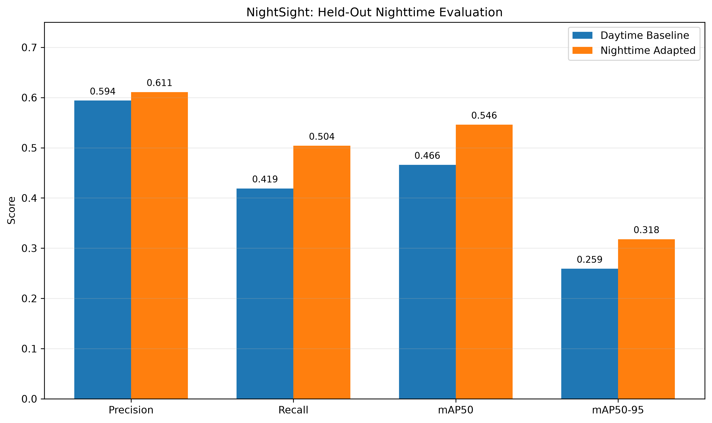
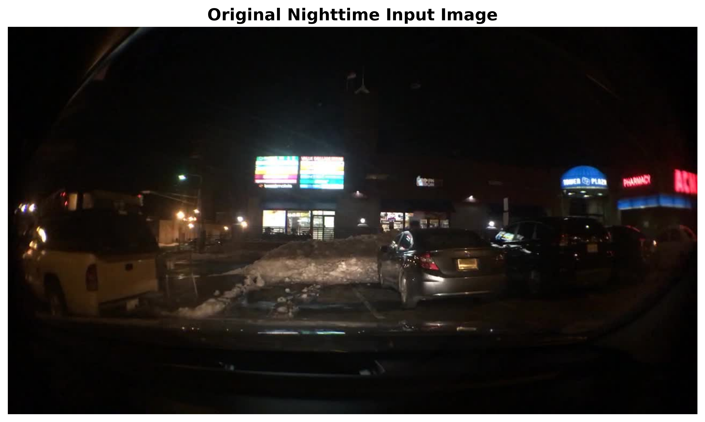
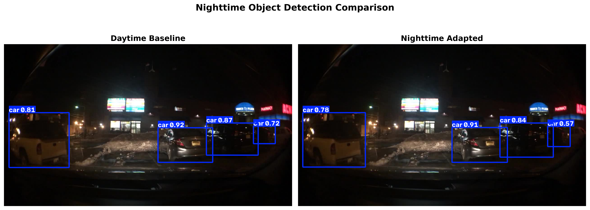

# NightSight: Adaptive Day-to-Night Domain Adaptation for Robust Object Detection

**NightSight** investigates whether a vehicle and pedestrian detector trained on daytime images can improve its nighttime detection performance through adaptation using labelled nighttime data.

The project uses **YOLO11s** as the baseline detector and applies nighttime fine-tuning to improve detection under challenging illumination conditions.

## 1. Problem Statement

Object detection models trained predominantly on daytime images can experience performance degradation at night due to:

- Low-light conditions and reduced visibility.
- Headlight glare and uneven illumination.
- Shadows and changes in object appearance.
- Reduced contrast between objects and backgrounds.

NightSight investigates whether domain adaptation using labelled nighttime images can address this day-to-night performance gap.

## 2. Objectives

- Establish a daytime-trained object detection baseline.
- Adapt the baseline model using labelled nighttime images.
- Evaluate both models on an independent held-out nighttime evaluation subset.
- Compare detection performance using Precision, Recall, mAP@50, and mAP@50–95.
- Analyse performance changes across individual object classes.

## 3. Dataset

The project uses a 10,000-image subset derived from BDD100K through a Hugging Face dataset mirror.

| Dataset partition | Images | Purpose |
|---|---:|---|
| Daytime training | 4,000 | Baseline model training |
| Nighttime adaptation | 3,000 | Nighttime fine-tuning |
| Nighttime validation | 1,500 | Model validation |
| Nighttime held-out evaluation | 1,500 | Final evaluation |
| **Total** | **10,000** | |

**Target classes:**
- Car
- Person
- Bus

The dataset was converted into YOLO-format bounding-box annotations and validated for image-label consistency and invalid bounding boxes.

The dataset itself is not included in this repository.

## 4. Methodology

The experimental workflow consists of two training stages.

### Stage 1: Daytime Baseline

- Initialize YOLO11s using pretrained weights.
- Train on 4,000 daytime images.
- Validate using 1,500 nighttime validation images.
- Save the best-performing checkpoint.

### Stage 2: Nighttime Adaptation

- Initialize from the trained daytime YOLO11s checkpoint.
- Fine-tune using 3,000 labelled nighttime images.
- Use a lower learning rate for adaptation.
- Validate using the same nighttime validation partition.

### Final Evaluation

Both models are evaluated on the same independent held-out subset of 1,500 nighttime images containing 15,298 annotated instances.

The held-out evaluation subset is separate from the training and validation partitions.

## 5. Experimental Results

### Overall Performance

The following table compares the daytime baseline against the nighttime-adapted model on the held-out nighttime evaluation subset.

| Metric | Daytime Baseline | Nighttime Adapted | Improvement |
|---|---:|---:|---:|
| Precision | 59.4% | 61.1% | +1.7 pp |
| Recall | 41.9% | 50.4% | +8.5 pp |
| mAP@50 | 46.6% | 54.6% | +8.0 pp |
| mAP@50–95 | 25.9% | 31.8% | +5.9 pp |

The adapted model achieved an **8.0 percentage-point improvement in mAP@50** and a **5.9 percentage-point improvement in mAP@50–95**.

### Class-wise mAP@50

| Class | Baseline | Adapted |
|---|---:|---:|
| Car | 61.3% | 70.6% |
| Person | 42.5% | 48.6% |
| Bus | 36.0% | 44.7% |

All three classes showed improvements in mAP@50. However, bus precision decreased after adaptation, so class-wise performance should be interpreted alongside the individual precision and recall metrics.

## 6. Results Visualization

### Overall Metric Comparison



### Nighttime Detection Comparison

**Original nighttime input**



**Baseline vs. Adapted YOLO11s**



## 7. Research Dashboard

The experimental results are also available in the research dashboard.

- [View Dashboard (PDF)](results/final_comparison/NightSight_Research_Dashboard.pdf)
- [View Dashboard (PNG)](results/final_comparison/NightSight_Research_Dashboard.png)
- [Download Evaluation Metrics (CSV)](results/metrics/held_out_evaluation_comparison.csv)

## 8. Technologies Used

- **Programming Language:** Python
- **Deep Learning Framework:** PyTorch
- **Object Detection:** Ultralytics YOLO11s
- **Computer Vision:** OpenCV
- **Data Analysis:** NumPy, Pandas, Matplotlib
- **Development Environment:** Jupyter Notebook, Visual Studio Code
- **Hardware:** NVIDIA RTX 4060 Laptop GPU

## 9. Repository Structure

```text
NightSight/
│
├── notebooks/
│   ├── 01_dataset_exploration.ipynb
│   └── 02_dataset_selection.ipynb
│
├── results/
│   ├── final_comparison/
│   │   ├── NightSight_Research_Dashboard.pdf
│   │   └── NightSight_Research_Dashboard.png
│   │
│   ├── metrics/
│   │   └── held_out_evaluation_comparison.csv
│   │
│   ├── plots/
│   │   └── overall_metric_comparison.png
│   │
│   └── predictions/
│       ├── Figure_1_Nighttime_Input.png
│       └── Figure_2_Baseline_vs_Adapted.png
│
├── .gitignore
└── README.md
```

## 10. Limitations and Future Work

- Evaluate whether nighttime adaptation causes performance degradation on daytime images.
- Investigate performance across different nighttime illumination conditions.
- Analyse failure cases involving distant objects, glare, and partially visible vehicles.
- Explore image enhancement techniques and compare them with domain adaptation.
- Conduct repeated experiments and statistical analysis to assess result stability.

## 11. Conclusion

NightSight demonstrates that fine-tuning a daytime-trained YOLO11s detector using labelled nighttime data can improve nighttime object detection performance.

On the held-out nighttime evaluation subset, the adapted model achieved improvements in all four overall evaluation metrics, with an 8.0 percentage-point increase in mAP@50.

The results provide an experimental basis for investigating domain adaptation as an approach to improving object detection under changing illumination conditions.

---

**Project:** NightSight  
**Focus:** Computer Vision | Object Detection | Domain Adaptation | Deep Learning  
**Architecture:** YOLO11s  
**Dataset:** BDD100K-derived subset
